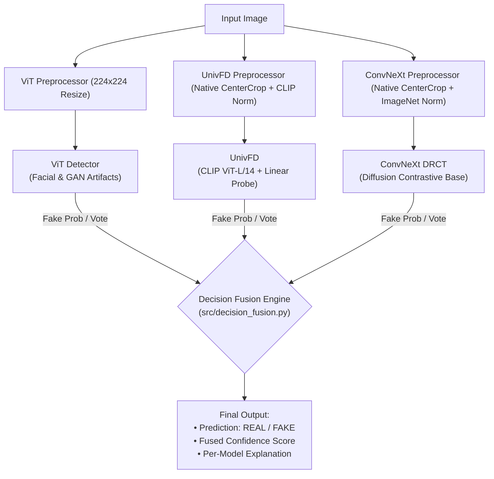
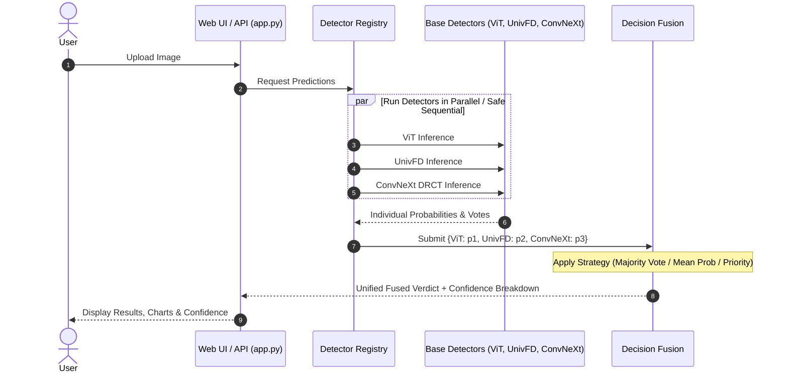
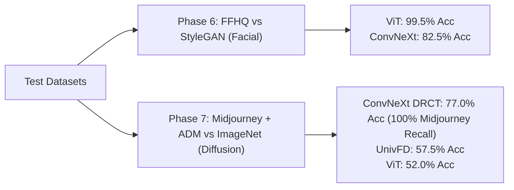

# Multi-Model Deepfake Detection & Cross-Generator Evaluation

A multi-model deepfake detection framework that combines specialized computer vision architectures to detect AI-generated and manipulated images across diverse generator families (GANs, Diffusion, Midjourney, StyleGAN, ADM).

---

## 💡 The Core Idea

Single deepfake detectors suffer from **generator overfitting**:
- A model trained on facial GANs (like StyleGAN) often fails on diffusion models (like Midjourney).
- A model trained on general diffusion artifacts might miss fine-grained facial manipulations.

**Our Solution:** 
Instead of relying on a single fallible detector, we run multiple complementary vision models with distinct inductive biases and combine their outputs using **deterministic decision fusion**.



---

## 🔍 The Base Detectors

| Model | Architecture | Specialization / Training | Key Strength |
|---|---|---|---|
| **ViT** | Vision Transformer (`dima806`) | Facial deepfakes & GAN faces | High sensitivity on facial boundaries and warping |
| **UnivFD** | CLIP ViT-L/14 + Linear Classifier | Multi-generator frequency & semantic cues | Universal zero-shot artifact sensitivity |
| **ConvNeXt DRCT** | ConvNeXt-Base (CVPR 2024) | Diffusion Reconstruction Contrastive Training | Outstanding generalization to diffusion (100% on Midjourney) |

---

## ⚙️ How It Works: Inference & Fusion Flow



### Fusion Strategies
1. **Majority Voting:** Collects discrete votes (`REAL` vs `FAKE`). If a tie occurs, falls back to probability thresholding.
2. **Mean Fake Probability:** Computes the unweighted average of calibrated fake probabilities across all active detectors.
3. **Domain Priority:** Selects primary detector based on input context (e.g. facial vs non-facial diffusion synthesis).
4. **Graceful Degradation:** If any detector fails or checkpoint is absent, the engine falls back gracefully without crashing.

---

## 📊 Evaluation & Parity Verification

Our framework was evaluated against both facial GAN benchmarks and external diffusion datasets (Midjourney v5, ADM, ImageNet nature photos):



- **Reference Parity:** All adapters match official paper implementations (CVPR 2023 UniversalFakeDetect and CVPR 2024 DRCT) with numerical differences $< 10^{-6}$.
- **Comprehensive Regression Tests:** Automated test suite with 25 unit and contract tests verifying preprocessing shapes, normalization, and fusion edge cases.

---

## 🚀 Quickstart

### 1. Installation
```bash
git clone https://github.com/Thiru-Selvam-06/Deepfake-Detection.git
cd Deepfake-Detection
pip install -r requirements.txt
```

### 2. Run the Interactive Web UI
```bash
python app.py
```
Open your browser at `http://localhost:7860`.

### 3. Run Automated Tests
```bash
pytest tests/ -v
```

---

## 📁 Repository Structure

```text
├── app.py                   # Gradio Web Interface
├── src/
│   ├── convnext_adapter.py  # DRCT Native Crop Preprocessing & Inference
│   ├── univfd_adapter.py    # UniversalFakeDetect CLIP Preprocessing & Inference
│   ├── vit_adapter.py       # Vision Transformer Adapter
│   ├── decision_fusion.py   # Multi-Model Voting & Probability Fusion Logic
│   └── detector_registry.py # Unified Lifecycle & Model Registry
├── benchmark/               # Labeled test manifests and evaluation results
├── tests/                   # Regression and unit tests for adapters and fusion
├── docs/                    # Detailed scientific evaluation reports
└── models/                  # Pretrained model weights and checkpoints (Git LFS)
```
