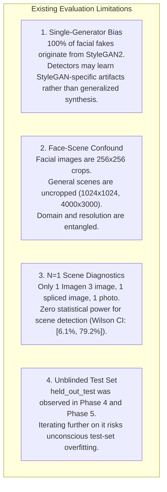
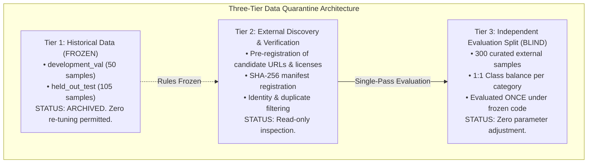
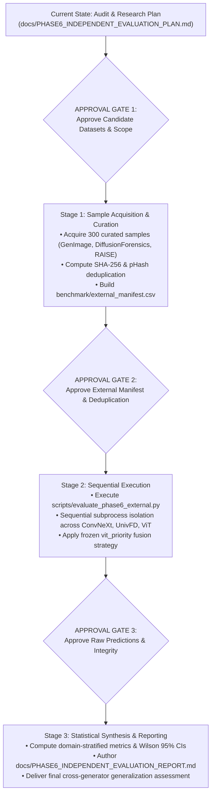

# Phase 6: Independent Cross-Generator Evaluation — Audit and Research Plan

**Project Root**: `C:\Users\user\Desktop\multi model connection`  
**Document**: `docs/PHASE6_INDEPENDENT_EVALUATION_PLAN.md`  
**Phase**: Phase 6 — Independent Cross-Generator Evaluation: Audit and Research Plan  
**Status**: Plan Only (Strictly No Code Modification, No Dataset Downloads, No Package Installation)  
**Date**: October 2026  

---

## 1. Executive Summary

This document presents a scientifically defensible research and evaluation plan for Phase 6 of the project: **Cross-Model Evaluation of Deepfake Image Detection Under Diverse Image Generation and Manipulation Conditions**.

### 1.1 Context and Problem Statement
Phases 1 through 5 of this project audited the repository, resolved a critical Windows virtual memory exhaustion error (`os error 1455`) via subprocess isolation, curated and verified a 159-sample manifest from local assets, executed a reproducible baseline benchmark on 105 held-out samples, and empirically tested multi-model decision fusion on 50 validation samples.

The core empirical findings from Phases 4 and 5 revealed:
1. **Facial Domain Specialization**: The Vision Transformer (`dima806/deepfake_vs_real_image_detection`) achieves **100.00% accuracy** ($100 / 100$) on the tested facial crops (Flickr-Faces-HQ authentic portraits vs. StyleGAN2 synthetic faces).
2. **General Scene Blindspots**: On modern latent diffusion (Google Imagen 3, $1024 \times 1024$) and localized digital composite splicing ($800 \times 800$), **all three integrated detectors failed at default thresholds**, misclassifying synthetic and manipulated scenes as `REAL` ($P_\text{fake} \le 34.24\%$).
3. **Failure of Naive Fusion**: Democratic decision fusion (majority voting and mean-probability averaging) caused severe performance degradation (dropping accuracy from $100.00\%$ to $74.00\%$ and $76.00\%$ respectively) because face-insensitive secondary models (UnivFD at $64.00\%$, ConvNeXt/DRCT at $58.00\%$) outvoted ViT on subtle synthetic faces. Only `vit_priority` preserved ViT's facial accuracy while providing a fault-tolerant fallback chain.
4. **Quarantine Status of Current Data**: The existing `held_out_test` partition ($N=105$) has already been observed twice (Phase 4 baseline and Phase 5 frozen verification). It is **no longer a blind test set**.

### 1.2 Objective of Phase 6
To escape the narrow domain of FFHQ-versus-StyleGAN facial crops, this plan establishes a methodology to evaluate whether `ViTAdapter`, `UnivFDAdapter`, `ConvNeXtAdapter`, and `vit_priority` generalize to **unseen generative architectures** (diffusion faces, diffusion scenes, commercial generators, image splicing, and post-processing degradations) without introducing data leakage, test-set overfitting, or hardware exhaustion.

---

## 2. Verified Current Project State

An independent audit of repository code, manifests, and historical logs confirms the following technical baseline:

### 2.1 Integrated Model Roster & Checkpoint Audit

| Detector Key | Adapter Class | Architecture Family | Checkpoint File / Identifier | Checkpoint Size | Decision Threshold | Input Resolution & Preprocessing | Label Mapping | Training Domain & Source |
| :--- | :--- | :--- | :--- | :---: | :---: | :--- | :---: | :--- |
| **`vit`** | `ViTAdapter` | Vision Transformer (`ViT-Base/16`) | `models/deepfake_vs_real_image_detection/model.safetensors` | 343.22 MB | 0.50 | $3 \times 224 \times 224$, Bicubic, Mean/Std `[0.5, 0.5, 0.5]` | 0: Real, 1: Fake | Fine-tuned on Kaggle 140k cropped faces |
| **`univfd`** | `UnivFDAdapter` | Vision-Language Probe (`CLIP ViT-L/14`) | `UniversalFakeDetect/pretrained_weights/fc_weights.pth` | 4.08 KB (probe) + ~1.7 GB (CLIP) | 0.50 | $3 \times 224 \times 224$, Bicubic, CenterCrop, OpenAI CLIP Mean/Std | 0: Real, 1: Fake (Sigmoid on single logit) | Linear probe trained on 2018 ProGAN artifacts |
| **`chen2024_convnext`** | `ConvNeXtDetectorAdapter` | ConvNeXt-Base | `models/chen2024_convnext/16_acc0.9993.pth` | 354.34 MB | 0.50 | $3 \times 224 \times 224$, ImageNet Mean/Std | 0: Real, 1: Fake | Trained on DRCT-2M with Stable Diffusion v2 reconstruction contrastive loss |

*Verification Source*: Checked via `src/detector_registry.py`, `src/vit_adapter.py`, `src/univfd_adapter.py`, and `src/convnext_adapter.py`.

### 2.2 Manifest Inventory & Sample Usage History

The active manifest [`benchmark/evaluation_manifest.csv`](file:///C:/Users/user/Desktop/multi%20model%20connection/benchmark/evaluation_manifest.csv) contains **159 verified rows**, partitioned as follows:

| Partition Name | Total Samples | Real | Fake | Control | Visual Domain | Generators Represented | Prior Usage History | Quarantine Status |
| :--- | :---: | :---: | :---: | :---: | :--- | :--- | :--- | :--- |
| **`held_out_test`** | **105** | 51 | 52 | 2 | 100 Facial Crops<br>3 General Scenes<br>2 Corrupted/Format | FFHQ (50)<br>StyleGAN2 (50)<br>Smartphone Photo (1)<br>Imagen 3 Diffusion (1)<br>Spliced Composite (1) | Evaluated in Phase 4 (baseline) and Phase 5 (`vit_priority`) | **EXHAUSTED AS BLIND TEST**; results already observed. |
| **`development_val`** | **50** | 25 | 25 | 0 | 50 Facial Crops | FFHQ (25)<br>StyleGAN2 (25) | Evaluated in Phase 5 to compare 4 fusion strategies | **EXHAUSTED AS VALIDATION**; used to freeze fusion rules. |
| **`operational_smoke`**| **4** | 1 | 2 | 1 | 3 General Scenes<br>1 Corrupted | Natural Photo (1)<br>Diffusion (1)<br>Composite (1) | CI contract & adapter regression checks | **RESERVED** strictly for smoke tests; excluded from metrics. |

*Historical Exploratory Samples (in `currently working`)*: An additional 2,530 samples were touched in past experiments (`Group A` 0..49, `Calibration` 400..499, `Holdout` 500..699, `random_250`, `extended_predictions`). All 150 facial samples currently in the manifest originate from the pristine index range ($1500 \le \text{index} \le 1574$) to avoid overlap with those historical subsets.

### 2.3 Sample-Level Metadata & Provenance Audit
- **Available Fields**: `sample_id`, `split`, `domain`, `category`, `ground_truth`, `source_dataset`, `generation_or_manipulation_method`, `label_evidence`, `verification_status`, `file_path`, `relative_path`, `file_format`, `width`, `height`, `file_size_bytes`, `sha256`.
- **Missing Sample-Level Metadata**:
  - **Subject Identity**: Not recorded for FFHQ faces (anonymous Flickr crawls).
  - **Generation Parameters**: Prompts, seeds, guidance scales, and latent noise vectors are unrecorded for the StyleGAN and Imagen 3 samples.
  - **Camera Hardware EXIF**: Stripped from all $256 \times 256$ facial crops during upstream Kaggle dataset packaging.
- **Identity & Near-Duplicate Leakage Assessment**:
  - Byte-level deduplication confirmed **zero exact duplicate hashes** between splits.
  - However, because the upstream Kaggle 140k dataset was partitioned randomly rather than clustered by facial identity embeddings, **latent-space identity overlap or near-duplicate poses between FFHQ/StyleGAN faces cannot be mathematically ruled out** in the existing manifest.

---

## 3. Limitations of the Existing Evaluation

The current evaluation framework suffers from four fundamental scientific limitations that Phase 6 must address:



### Detailed Limitations Breakdown:
1. **Single-Generator Facial Monoculture**: Every synthetic face in `held_out_test` ($N=50$) and `development_val` ($N=25$) was synthesized by NVIDIA StyleGAN2. Zero samples represent modern latent diffusion faces (Stable Diffusion XL portraits, Midjourney portraits, Flux.1 faces), identity swapping (DeepFaceLab, SimSwap), or face morphing.
2. **Domain-Resolution Entanglement**: In the existing benchmark, all facial images are $256 \times 256$ pixels, while general scenes are $800 \times 800$, $1024 \times 1024$, or $4000 \times 3000$ pixels. A detector's failure on general scenes could stem from resolution downsampling, lack of facial alignment, or generative model differences, without the ability to isolate the root cause.
3. **Statistically Meaningless Scene Sample Size**: With exactly $N=1$ sample per scene category, calculated scene accuracy ($33.33\%$) carries an extreme 95% Wilson confidence interval of $[6.15\%, 79.23\%]$. It serves as a qualitative canary test, not a valid benchmark metric.
4. **Absence of Post-Processing & Perturbations**: All current test images are uncompressed or high-quality originals. In-the-wild deepfakes undergo social media recompression (JPEG quality 30–75, WebP, WhatsApp downsampling), motion blur, and color grading.

---

## 4. External Dataset Comparison Table

To address these limitations, public deepfake and synthetic image datasets were surveyed against verified academic publications and official repositories:

| Dataset Name & Official Source | Image Modalities | Generative & Manipulation Methods | Scale & Label Structure | Licensing & Access Terms | Known Provenance & Leakage Considerations | Domain Novelty vs. Current Project | Hardware Compatibility (8GB RAM / 4GB VRAM) |
| :--- | :--- | :--- | :--- | :--- | :--- | :--- | :--- |
| **GenImage**<br>[`github.com/GenImage-Dataset/GenImage`](https://github.com/GenImage-Dataset/GenImage)<br>NeurIPS 2023 | Real + Synthetic | **8 Generators**: Stable Diffusion (v1.4, v1.5), Midjourney, ADM, GLIDE, Wukong, VQDM, BigGAN | 1,331,167 images (899k train, 432k val/test). 1:1 Real/Fake balance per generator. | **CC BY-NC-SA 4.0** (Open academic research use; non-commercial). Direct download. | Real images sourced from ImageNet-1K; potential overlap with ConvNeXt pretraining backbone. | **HIGH**. Covers 7 unseen diffusion architectures + BigGAN across general visual scenes. | **EXCELLENT**. Standard JPEG/PNG format, evaluates in small sequential batches. |
| **DiffusionForensics (DIRE)**<br>[`github.com/ZhendongWang6/DIRE`](https://github.com/ZhendongWang6/DIRE)<br>ICCV 2023 | Real + Synthetic | **Diffusion Models**: ADM, DDPM, iDDPM, PNDM, LDM | ~100,000 images across LSUN-Bedroom, ImageNet, and **CelebA-HQ** | Open academic research use (Hosted on Baidu/RecDrive; code under MIT). | Real faces from CelebA-HQ; potential identity overlap with FFHQ subjects crawled from Flickr. | **VERY HIGH**. Provides **diffusion-generated human faces** (CelebA-HQ), directly challenging ViT's facial generalization. | **GOOD**. $256 \times 256$ and $512 \times 512$ resolutions load easily in memory. |
| **FaceForensics++ (FF++)**<br>[`github.com/ondyari/FaceForensics`](https://github.com/ondyari/FaceForensics)<br>ICCV 2019 | Real + Manipulated | **5 Facial Manipulations**: Deepfakes, Face2Face, FaceSwap, NeuralTextures, FaceShifter | 1,000 original YouTube video sequences + manipulated counterparts; 3 compression levels (c0, c23, c40). | **FaceForensics Terms of Use** (Requires signed application form; non-commercial). | YouTube video origins; real identities are public video creators. | **VERY HIGH**. Introduces **face-swapping and facial reenactment**, completely absent from current data. | **MODERATE**. Video files require frame extraction ($224 \times 224$ crops) prior to sequential inference. |
| **Celeb-DF (v2)**<br>[`github.com/yuezunli/celeb-deepfakeforensics`](https://github.com/yuezunli/celeb-deepfakeforensics)<br>CVPR 2020 | Real + Manipulated | **DeepFaceLab Face-Swapping** (High-quality identity replacement with temporal blending) | 590 real celebrity YouTube videos + 5,639 high-grade DeepFake videos (~2M frames). | **Celeb-DF Terms of Use** (Application form required; research-only). | Celebrity subjects (actors, politicians); zero overlap with FFHQ Flickr users. | **HIGH**. Evaluates high-fidelity face-swapping designed to defeat edge artifacts. | **MODERATE**. Requires frame extraction; single-frame evaluation is lightweight. |
| **CASIA v2.0**<br>[`forensics.idealtest.org`](http://forensics.idealtest.org)<br>ChinaSIP 2013 | Real + Manipulated | **Digital Splicing & Copy-Move** (Local spatial pasting, boundary post-processing) | 12,615 images (7,491 authentic, 5,124 tampered). JPEG, BMP, TIFF formats. | Academic non-commercial research use only; registration required. | Sourced from Corel dataset and personal digital photos. Zero generative AI; pure manual digital manipulation. | **HIGH**. Expands the $N=1$ composite probe into a statistically valid image splicing benchmark. | **EXCELLENT**. Variable resolutions ($384 \times 256$ to $800 \times 600$) easily handled on 4GB VRAM. |
| **RAISE**<br>[`mmlab.science.unitn.it/RAISE`](http://mmlab.science.unitn.it/RAISE/)<br>ACM MMSys 2015 | Authentic Real Only | **Camera Sensor Hardware Capture** (Nikon D90, D7000, D40 uncompressed RAW/TIFF) | 8,156 uncompressed RAW images (Subsets: RAISE-1k, RAISE-2k) with full EXIF camera parameters. | Open research use. Direct download from University of Trento. | Strictly authentic photographic capture with verified hardware provenance. | **HIGH**. Provides pristine camera hardware ground truth to rigorously test detector False Positive Rates. | **GOOD**. RAW files require conversion to uncompressed PNG/JPEG for adapter ingestion. |
| **AIGCDetectBenchmark**<br>[`github.com/Ekko-zn/AIGCDetectBenchmark`](https://github.com/Ekko-zn/AIGCDetectBenchmark)<br>CVPR 2024 | Real + Synthetic | **Multi-Generator Cross-Domain**: ProGAN, BigGAN, StyleGAN, SDv1.4, SDv1.5, SDXL, Midjourney, DALL-E 2 | Standardized benchmark splits with diverse generators. | Open academic research use (Hugging Face mirror available). | Combines multiple upstream sources; requires per-source tracking. | **VERY HIGH**. Pre-aggregated cross-generator benchmark specifically created for detector comparison. | **EXCELLENT**. Standardized image dimensions matching CLIP/ViT inputs. |

---

## 5. Recommended Dataset Shortlist and Rationale

To maintain experimental tractability and prevent hardware exhaustion on the local workstation (8 GB RAM, RTX 3050 4 GB VRAM), a curated, balanced shortlist of **three complementary datasets** is recommended:

```
Proposed Independent External Benchmark (Target: 300 New Samples)
├── Partition 1: Unseen Generative Faces (100 samples)
│   ├── 50 Authentic Real Faces (CelebA-HQ / Celeb-DF Real)
│   └── 50 Diffusion Faces (DiffusionForensics CelebA-HQ: LDM & DDPM)
│
├── Partition 2: Unseen Facial Manipulations (100 samples)
│   ├── 50 Authentic Video Frames (FaceForensics++ Real c23)
│   └── 50 Face-Swapped Frames (FaceForensics++ Deepfakes & FaceShifter c23)
│
└── Partition 3: Unseen General Scenes & Splicing (100 samples)
    ├── 25 Authentic Camera Photographs (RAISE-1k uncompressed)
    ├── 25 Authentic Scene Photos (ImageNet / MSCOCO)
    ├── 25 Modern Diffusion Scenes (GenImage: Midjourney & SDXL)
    └── 25 Spliced / Manipulated Scenes (CASIA v2.0 splicing)
```

### 5.1 Shortlist Selection Rationale

1. **DiffusionForensics (CelebA-HQ Partition)**:
   - *Rationale*: Isolates the **Face vs. Generator confound**. In Phase 4, ViT scored 100% on StyleGAN faces but failed on Imagen 3 scene diffusion. Testing ViT on diffusion-generated human faces will resolve whether ViT's strength is *human facial geometry* or *StyleGAN-specific frequency artifacts*.
2. **FaceForensics++ (c23 High-Quality Partition)**:
   - *Rationale*: Tests **identity-swapping and boundary manipulation**. The current project has zero face-swap samples. Testing on FaceForensics++ c23 (compressed) reflects real-world deepfake distribution where high-frequency GAN artifacts are partially smoothed by H.264 video compression.
3. **GenImage (Midjourney & SDXL Subsets) + CASIA v2.0**:
   - *Rationale*: Solves the $N=1$ limitation of `test_scene_diffusion_001` and `test_scene_manip_001`. Provides statistically powered evaluation of modern diffusion architectures (Midjourney, SDXL) and digital splicing, testing whether ConvNeXt/DRCT or UnivFD outperform ViT on non-facial visual scenes.

---

## 6. Proposed Split and Leakage-Prevention Protocol

To maintain scientific integrity and prevent unblinded optimization, Phase 6 must adhere to a strict three-tier data quarantine architecture:



### 6.1 Leakage-Prevention Rules:
1. **Pre-Evaluation Code Freezing**:
   - Detector adapters (`src/vit_adapter.py`, `src/univfd_adapter.py`, `src/convnext_adapter.py`) must be locked.
   - Decision thresholds (fixed at $0.50$) and preprocessing pipelines must NOT be adjusted based on external data previews.
   - The fusion strategy (`vit_priority`) selected in Phase 5 must be evaluated without modification.
2. **Backbone Training Set Overlap Screening**:
   - `ConvNeXt/DRCT` was trained on MSCOCO and Stable Diffusion v1.4 reconstructions. External real images should prioritize sources outside MSCOCO (e.g., RAISE, CelebA-HQ).
   - `UnivFD` was trained on OpenAI CLIP ViT-L/14, which saw 400M web images. Real-image source attribution must be documented to acknowledge potential web pretraining overlap.
   - `ViT` was trained on Kaggle 140k (FFHQ + StyleGAN2). External faces from Celeb-DF and CelebA-HQ must be verified for identity separation.
3. **Near-Duplicate & Perceptual Hash Filtering**:
   - All newly ingested candidate images must undergo both SHA-256 exact matching and perceptual hashing (pHash) against all 190,335 images in `currently working/Dataset` and `benchmark/images`.
   - Any sample with Hamming distance $\le 4$ against existing training/test samples must be excluded.
4. **Identity-Level Separation for Faces**:
   - Multiple video frames from the same video clip or identity in FaceForensics++ / Celeb-DF must NOT be split across evaluation groups. All frames from a single video identity must reside in the same evaluation batch.

---

## 7. Metrics and Statistical Analysis Plan

To prevent misleading claims arising from small subgroups or imbalanced categories, the evaluation protocol defines exact statistical requirements:

### 7.1 Quantitative Classification Metrics
For each detector and the frozen fusion engine, report:
- **Sample Counts**: Total evaluated ($N$), successfully evaluated, inference errors.
- **Confusion Matrix**: True Positives (TP), False Positives (FP), True Negatives (TN), False Negatives (FN).
- **Core Metrics**:
  $$\text{Accuracy} = \frac{\text{TP} + \text{TN}}{\text{TP} + \text{TN} + \text{FP} + \text{FN}}$$
  $$\text{Balanced Accuracy} = \frac{1}{2} \left( \frac{\text{TP}}{\text{TP} + \text{FN}} + \frac{\text{TN}}{\text{TN} + \text{FP}} \right)$$
  $$\text{Precision} = \frac{\text{TP}}{\text{TP} + \text{FP}}, \quad \text{Recall} = \frac{\text{TP}}{\text{TP} + \text{FN}}, \quad \text{Specificity} = \frac{\text{TN}}{\text{TN} + \text{FP}}$$
  $$F_1 = \frac{2 \cdot \text{Precision} \cdot \text{Recall}}{\text{Precision} + \text{Recall}}$$

### 7.2 Confidence Intervals and Sample Size Rules
- All classification metrics must include **Wilson Score 95% Confidence Intervals**:
  $$w = \frac{p + \frac{z^2}{2n} \pm z \sqrt{\frac{p(1-p)}{n} + \frac{z^2}{4n^2}}}{1 + \frac{z^2}{n}}$$
  where $z = 1.96$ for a $95\%$ confidence level.
- **Reporting Threshold**: Aggregate category metrics are permitted ONLY for subcategories with $N \ge 25$ samples. Categories with $N < 25$ must be reported as individual diagnostic probe listings.

### 7.3 Multi-Level Domain Stratification
Results must be partitioned and reported along three orthogonal dimensions:
1. **By Visual Domain**:
   - `Facial Portraits` (aligned crops) vs. `General Scenes` (uncropped scenes, landscapes, objects).
2. **By Manipulation Family**:
   - `GAN Synthesis` (StyleGAN, ProGAN, BigGAN).
   - `Diffusion Synthesis` (Stable Diffusion, Midjourney, Imagen, LDM).
   - `Face Swapping` (DeepFaceLab, FaceShifter).
   - `Digital Splicing` (CASIA copy-move, composite paste).
   - `Authentic Photography` (RAISE, ImageNet, CelebA-HQ).
3. **By Robustness / Perturbation Level**:
   - `Uncompressed / Raw` vs. `Compressed (c23 / JPEG Q=50)` vs. `Downsampled`.

---

## 8. Hardware and Runtime Considerations

The evaluation execution must run safely on the local workstation:
- **Operating System**: Windows 11 Home (Build 26200).
- **Host CPU**: AMD Ryzen 5 5600H (6 cores, 12 threads).
- **System Memory**: 8.0 GB Physical RAM.
- **GPU**: NVIDIA GeForce RTX 3050 Laptop GPU (4.0 GB VRAM).
- **Python Environment**: Python 3.13.13, PyTorch 2.13.0+cpu, timm 1.0.29, transformers 5.17.0.

### 8.1 Memory-Safety Protocols:
1. **Subprocess Isolation**: Each detector model must execute in a separate Python subprocess, exactly as implemented in `scripts/run_phase4_baseline_evaluation.py`. The child process loads the model, evaluates its batch, flushes results to disk, and terminates, guaranteeing $100\%$ virtual memory release back to Windows (`os error 1455` mitigation).
2. **Sequential Queueing**: Detectors must execute strictly in sequence:
   $$\text{Run ConvNeXt/DRCT} \longrightarrow \text{Process Exits} \longrightarrow \text{Run UnivFD} \longrightarrow \text{Process Exits} \longrightarrow \text{Run ViT} \longrightarrow \text{Process Exits}$$
   Never load two models simultaneously into the same process space.
3. **Batch Sizing & Input Streaming**: Images must be loaded as individual PIL image handles and closed immediately after preprocessing, avoiding large in-memory image tensor arrays.
4. **Expected Execution Latency**:
   - Based on Phase 4 benchmarks (315 inferences in 345.9s $\approx 1.1\text{s/sample}$ across all 3 models):
   - A 300-sample external benchmark ($3 \times 300 = 900$ inferences) will execute in approximately **10 to 12 minutes** on CPU without risk of memory overflow.

---

## 9. Risks, Limitations, and Unresolved Questions

### 9.1 Technical & Methodological Risks:
1. **Web Pretraining Contamination**: CLIP (`UnivFD`) was pretrained on 400M internet image-text pairs; ConvNeXt was pretrained on ImageNet-22k. Completely guaranteeing that an authentic external photograph was never seen during foundational pretraining is impossible for modern foundation backbones.
2. **Access & Licensing Barriers**: Datasets such as FaceForensics++ and Celeb-DF require institutional verification and signed request forms. If academic approval is delayed, alternative open-license benchmarks (e.g. GenImage on Hugging Face, RAISE direct download) must be prioritized.
3. **Upstream Alignment Mismatch**: `ViTAdapter` expects pre-cropped facial bounding boxes. Evaluating full video frames from FaceForensics++ without an upstream face detection crop will cause resolution distortion. A standardized MTCNN or RetinaFace crop stage must be clearly documented if full frames are ingested.

### 9.2 Explicit Assumptions vs. Verified Facts:

| Item | Fact, Assumption, or Unresolved Question | Supporting Evidence / Source |
| :--- | :--- | :--- |
| **ViT Face Specialization** | **VERIFIED FACT** | 100% accuracy on 100 held-out facial samples (`phase4_baseline_metrics.json`). |
| **Diffusion Scene Blindspot** | **VERIFIED FACT** | All 3 models scored $P(\text{fake}) \le 34.24\%$ on Imagen 3 diffusion scene (`phase4_baseline_predictions.csv`). |
| **ViT Generalization to Diffusion Faces** | **UNRESOLVED QUESTION** | Unknown whether ViT detects diffusion artifacts in faces or only StyleGAN texture artifacts. Requires Phase 6 testing. |
| **FaceForensics++ Frame Extraction** | **ASSUMPTION** | Assumed that extracting cropped face frames at $256 \times 256$ maintains compatibility with `ViTAdapter` input expectations. |
| **Zero Prior Contamination of RAISE** | **VERIFIED FACT** | RAISE images are raw Nikon camera sensor files never included in Kaggle 140k or DRCT-2M training sets. |

---

## 10. Staged Implementation Plan with Explicit Approval Gates

Implementation of Phase 6 must proceed through four strictly gated stages:



### Stage Summary:
- **Gate 1 (Current Stop Point)**: User reviews and approves the candidate dataset selection, licensing terms, and sample sizing.
- **Stage 1 (Acquisition & Manifesting)**: Download only the approved samples, execute perceptual hash deduplication, and compile `benchmark/external_manifest.csv`. No inference.
- **Gate 2**: User verifies manifest integrity, balance, and lack of training set overlap.
- **Stage 2 (Inference Execution)**: Run sequential, subprocess-isolated evaluation across the 3 detectors and frozen `vit_priority` engine. Export raw logs to `benchmark/results/phase6_external_predictions.csv`.
- **Gate 3**: User inspects error logs and valid prediction counts.
- **Stage 3 (Reporting)**: Synthesize metrics, calculate Wilson confidence intervals, and author `docs/PHASE6_INDEPENDENT_EVALUATION_REPORT.md`.

---
*Report completed in accordance with Phase 6 Strict Operating Rules. All existing code, weights, manifests, and Phase 4/5 deliverables remain unmodified. Execution is stopped awaiting user review and approval.*

